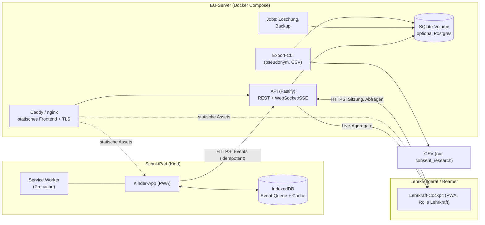
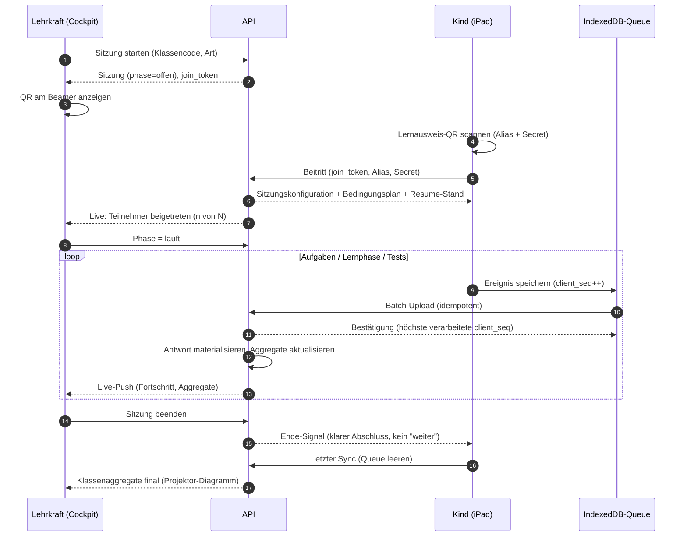

# 03 — Systemarchitektur

Status: Entwurf (Docs-Phase, kein App-Code). Quelle der Wahrheit für die Build-Phasen in `PLAN.md`.
Verwandte Dokumente: [01-konzept.md](01-konzept.md) · [02-lerndetektive-experiment.md](02-lerndetektive-experiment.md) · [04-datenschutz-genehmigungen.md](04-datenschutz-genehmigungen.md) · [05-forschungsplan.md](05-forschungsplan.md) · Dossier: [research/00-dossier.md](research/00-dossier.md) (§4.3, §5.2).

Konvention: Alles, was sich auf Apple-/MDM-Verhalten, SSO-Details oder Rechtsfragen bezieht und nicht gesichert aktuell ist, ist mit **zu verifizieren (R0)** markiert (R0 = Recherchephase Dez 2026–Jan 2027, siehe [05-forschungsplan.md](05-forschungsplan.md)).

---

## 1. Überblick & Leitprinzipien

Lerntyp ist eine PWA für Klassen der 4. Jahrgangsstufe (9–10 Jahre) in Baden-Württemberg, genutzt gemeinsam im Unterricht (45 Minuten) auf geteilten Schul-iPads, plus ein Lehrkraftgerät am Beamer. Ein kleiner Server in der EU sammelt Ereignisse und zeigt der Lehrkraft Klassenaggregate.

| Prinzip | Konsequenz in der Architektur |
|---|---|
| **Privacy by Design / Datensparsamkeit** | Keine Klarnamen, nur Alias ("Fuchs-27"). Zuordnung Alias ↔ Name existiert nur auf der Papierliste der Lehrkraft. Es werden nur Daten erhoben, die ein Dokument (01/02/05) konkret braucht. |
| **Forschungsdaten nur mit Einwilligung** | Flag `consent_research` pro Teilnehmer (von der Lehrkraft gesetzt). Ohne Flag: Kind nimmt teil, Daten fließen nicht in den Forschungsexport (Details: [04](04-datenschutz-genehmigungen.md)). |
| **Offline-first** | Schul-WLAN ist unzuverlässig. Alle Interaktionen laufen lokal weiter; Ereignisse werden in IndexedDB gequeued und später idempotent hochgeladen. |
| **Keine Drittanfragen** | Keine CDNs, Webfonts, Analytics, Tracker, SDKs. Alle Assets (inkl. Schrift, Audio, Bilder) werden vom eigenen Origin ausgeliefert. |
| **Portables Hosting** | Frontend = statischer Build, Backend = Docker-Compose-Stack. Keine herstellerspezifischen Features (keine Vercel Functions/Edge Config, keine proprietären DBs). Umzug zwischen Hostern = Konfigurationsänderung. |
| **Keine Dark Patterns** | Kein Streak, kein Leaderboard, keine Countdown-/FOMO-Elemente, kein Lootbox-Mechanismus; Sitzung hat ein klares Ende (Dossier §4.3). Architektur-Folge: kein Push, keine Hintergrund-Benachrichtigungen, keine Ranglisten-API. |
| **Keine Typ-Labels** | Das Datenmodell kennt kein Feld "Lerntyp". `Profil` enthält Stärken in sechs Strategien, keine Typzuordnung (siehe [01-konzept.md](01-konzept.md)). |
| **Inhalte als Daten** | Items, Texte, Aufgaben liegen als JSON unter `/data`, nicht im Code. |

---

## 2. Komponenten

| # | Komponente | Rolle | Läuft auf |
|---|---|---|---|
| a | **Kinder-App** | PWA: Beitritt per Alias-QR, Lerndetektive, Strategiekurs, "Mein Lernprofil". Offline-fähig. | Schul-iPad (Safari/Web-Clip) |
| b | **Lehrkraft-Cockpit** | Gleiche PWA, Rolle "Lehrkraft": Sitzung starten, QR am Beamer, Live-Fortschritt (nur auf dem Lehrkraftgerät, nicht am Beamer), Klassenaggregate, Profilkarten je Alias. Hinweis in jeder Ansicht mit Kinderdaten: „Nur zur Lernbegleitung – nicht für die Grundschulempfehlung oder Kompass 4.“ | Lehrkraftgerät |
| c | **API-Server** | Auth (Klassenzugang), Sitzungsverwaltung, Event-Ingest, Aggregation, Live-Kanal (WebSocket/SSE), Löschjobs, Export. | Server (EU) |
| d | **Datenbank** | Persistenz von Klassen, Sitzungen, Teilnehmern, Ereignissen, Antworten, Profilen. | Server (SQLite-Datei, optional Postgres) |
| e | **Forschungsexport** | Pseudonymisierter CSV-Export, nur `consent_research = true`, Alias durch zufällige Forschungs-ID ersetzt. Offline-Skript/CLI, kein offener Web-Endpunkt. | Server-CLI, Ausführung durch berechtigte Person |



Abgrenzung: Das Frontend ist ein reiner statischer Build und kennt die API-Basis-URL nur über eine Laufzeit-/Build-Konfiguration. Im **Demo-Modus** (Stufe 1) wird statt der API ein In-Browser-Mock verwendet (siehe §7).

---

## 3. Tech-Stack & Repo-Struktur

### 3.1 Struktur

```
lerntyp/
├─ apps/
│  ├─ web/            # React + Vite + vite-plugin-pwa (Kinder-App + Cockpit)
│  └─ api/            # Fastify, DB-Zugriff, Export-CLI, Jobs
├─ packages/
│  └─ shared/         # zod-Schemas, Typen, Event-Envelope, Aggregationslogik
├─ data/              # Items, Aufgaben, Texte als JSON (Inhalt ≠ Code)
├─ deploy/            # docker-compose.yml, Caddyfile, .env.example
├─ docs/
├─ PLAN.md
└─ CLAUDE.md
```

### 3.2 Entscheidungen

| Baustein | Wahl | Begründung |
|---|---|---|
| Sprache/Repo | TypeScript, Monorepo (npm/pnpm Workspaces) | Ein Typsystem von Client bis DB; `packages/shared` verhindert Schema-Drift. |
| Frontend | React + Vite | Verbreitet, schneller Build, statische Ausgabe → host-portabel. |
| PWA | `vite-plugin-pwa` (Workbox) | Precache der App-Shell und Medien für Offline; Web-Manifest für Web-Clip/Startbildschirm. |
| API | Fastify | Leichtgewichtig, schnelle Validierung, gute TS-Unterstützung, eingebaute Rate-Limit-Plugins. |
| Live-Kanal | WebSocket **oder** SSE | Cockpit braucht nur Server→Client-Push; SSE ist einfacher und proxy-freundlich, WebSocket bei späterem Bedarf an Rückkanal. Entscheidung in Phase P3 per Prototyp (offen, §11). |
| Datenbank | SQLite (Pilot), Postgres optional | Pilot: ein Prozess, eine Datei, triviales Backup, kein DB-Betrieb. Postgres bei mehreren API-Instanzen oder höherer Last. Zugriff über dünne Repository-Schicht, damit der Wechsel lokal bleibt. |
| Validierung | `zod`, geteilt | Dasselbe Schema validiert auf Client (vor Queue) und Server (beim Ingest); Typen werden abgeleitet. |
| Tests | Vitest (Unit/Integration), Playwright (E2E) | Playwright mit iPad-Viewport/WebKit-Engine, Offline-Szenarien (Netz trennen, Storage leeren). Echtgerätetest auf Shared iPad bleibt nötig (R0/R2). |
| Inhalte | JSON unter `/data`, per zod geprüft | Items änderbar ohne Codeänderung; Build schlägt bei ungültigem JSON fehl. |
| Deployment | Docker Compose | Reproduzierbar auf jedem EU-Host oder Schulträger-Server. |

Nicht verwendet: serverseitiges Rendering, Cloud-Datenbanken, Auth-as-a-Service, Fonts/Icons von CDNs, Analytics.

---

## 4. Datenmodell

Alle IDs sind zufällig (UUIDv4/ULID), nie aus Personendaten abgeleitet. Zeitstempel in UTC (ISO 8601).

### 4.1 Klasse

| Feld | Typ | Beschreibung |
|---|---|---|
| `id` | id | Primärschlüssel |
| `code` | string | Klassenspezifischer Lehrkraft-Zugangscode (zufällig, ausreichend lang; im Pilot der einzige Lehrkraftzugang, kein Lehrkraft-Konto) |
| `schuljahr` | string | z. B. `2026/27`; steuert Löschfrist |
| `loeschdatum` | date | Automatische Löschung (Schuljahresende, konfigurierbar) |
| `erstellt_am` | timestamp | |

Kein Schulname, keine Lehrkraftnamen im Pilot, sofern nicht zwingend (Datensparsamkeit; Klärung in [04](04-datenschutz-genehmigungen.md)).

### 4.2 Sitzung

| Feld | Typ | Beschreibung |
|---|---|---|
| `id` | id | |
| `klasse_id` | id | FK |
| `art` | enum | `haupt` · `folge` (Hauptstunde bzw. Folgestunde) |
| `bezug_sitzung_id` | id/null | Nur bei `art = folge`: FK auf die zugehörige Hauptstunde |
| `phase` | enum | `offen` · `laeuft` · `beendet` (steuert Beitritt, Ende) |
| `join_token` | string | Kurzlebiger Token im QR am Beamer |
| `gestartet_am` / `beendet_am` | timestamp | |

Eine Sitzung umfasst alle Module einer Stunde (Start, Lerndetektive, Strategie-Parcours, Profil); es gibt kein Einzel-Modulfeld an der Sitzung. Die Bedingungszuordnung (Latin Square, [02](02-lerndetektive-experiment.md)) liegt pro Teilnehmer (`rotation`, `seed`), nicht pro Sitzung.

### 4.3 Teilnehmer

| Feld | Typ | Beschreibung |
|---|---|---|
| `id` | id | |
| `klasse_id` | id | FK |
| `alias` | string | z. B. `Fuchs-27`, eindeutig je Klasse; steht auf dem gedruckten Lernausweis |
| `alias_secret` | string | Im Lernausweis-QR; Hash gespeichert, nicht Klartext |
| `consent_research` | bool | Von der Lehrkraft gesetzt (Default `false`) |
| `consent_gesetzt_am` | timestamp | Nachvollziehbarkeit |
| `rotation` | enum | `ROT1` · `ROT2` · `ROT3` (Latin-Square-Rotation, siehe [02](02-lerndetektive-experiment.md); R0–R4 bezeichnen ausschließlich Forschungsphasen) |
| `seed` | int | Zufallssamen für Itemreihenfolge/Zuordnung, reproduzierbar |

Keine Namen, kein Geburtsdatum, keine Geräte-ID. Die Vorlesefunktion ist für jedes Kind an; es wird kein Barrierefreiheits- oder DaZ-Merkmal pro Kind gespeichert.

### 4.4 Ereignis (generischer Envelope)

Jede Interaktion wird als Ereignis erfasst. Der Envelope ist für alle Module gleich:

| Feld | Typ | Beschreibung |
|---|---|---|
| `id` | id | Client-generiert (UUID) |
| `sitzung` | id | Sitzungs-ID |
| `teilnehmer_alias` | string | Alias des Kindes |
| `modul` | enum | `start` · `lerndetektive` · `parcours` · `profil` |
| `typ` | string | Ereignistyp, siehe Payload-Tabelle unten und [02](02-lerndetektive-experiment.md) §9 |
| `zeitstempel` | timestamp | Client-Zeit (UTC); Server ergänzt `empfangen_am` |
| `client_seq` | int | Monoton steigend pro Teilnehmer und Sitzung, lückenlos vergeben |
| `payload` | json | Typspezifisch, per zod je `typ` validiert |

Eindeutigkeit/Idempotenz: `UNIQUE(sitzung, teilnehmer_alias, client_seq)`. Doppelter Upload wird ignoriert (Antwort: bereits vorhanden).

**Lerndetektive-Payloads** (Präferenzfragen, Lernphase, Bedingungen `wort` / `bild` / `bild_wort`, Sofort- und verzögerter Test) sind abschließend in [02-lerndetektive-experiment.md](02-lerndetektive-experiment.md) §9 definiert (u. a. `rt_ms`, `test` ∈ `sofort`|`verzoegert`, `zeitpunkt` ∈ `vorher`|`nachher`). Die Feldnamen dort gelten auch hier. Die Payloads von Strategie-Parcours und Profil definiert dieses Dokument:

| `typ` | `modul` | Payload |
|---|---|---|
| `ziel_gesetzt` | parcours | `{station, ziel: 1..5}` |
| `sicherheit_vorher` | parcours | `{station, smiley: 1..4}` |
| `aufgabe_gezeigt` | parcours | `{station, aufgabe_id}` |
| `beispiel_geoeffnet` | parcours | `{station, aufgabe_id}` |
| `hinweis_genutzt` | parcours | `{station, aufgabe_id, stufe: 1\|2}` |
| `antwort_abgegeben` | parcours | `{station, aufgabe_id, korrekt, versuch: 1\|2, rt_ms}` |
| `aufgabe_uebersprungen` | parcours | `{station, aufgabe_id}` |
| `hilfreich_gewaehlt` | parcours | `{station, strategien: string[]}` |
| `profil_angezeigt` | profil | `{karten_ids, superkraft}` |
| `profil_passt` | profil | `{smiley: 1..4}` (RQ6) |
| `superkraft_ausprobiert` | profil | `{antwort: "ja"\|"ein_bisschen"\|"nein"}` (Folgestunde) |
| `hilfe_angefordert` | modulübergreifend | `{}` |
| `pause` | modulübergreifend | `{aktiv}` |

Die Schemas werden in `packages/shared` als zod-Payload-Schemas je `typ` geführt.

### 4.5 Antwort

Abgeleitete, abfragefreundliche Sicht auf Antwort-Ereignisse (wird beim Ingest materialisiert; Ereignis bleibt die Wahrheit).

| Feld | Typ | Beschreibung |
|---|---|---|
| `id` | id | |
| `ereignis_id` | id | FK |
| `teilnehmer_id` | id | FK |
| `item_id` | string | Verweis in `/data` |
| `bedingung` | enum/null | `wort` · `bild` · `bild_wort` (nur Experiment) |
| `test` | enum/null | `sofort` · `verzoegert` |
| `korrekt` | bool/null | |
| `rt_ms` | int | Antwortzeit in ms |
| `versuch` | int | Nr. des Versuchs (für "Wiederholung nach Fehler") |

### 4.6 Profil

| Feld | Typ | Beschreibung |
|---|---|---|
| `teilnehmer_id` | id | FK |
| `staerken` | json | Bis zu drei Strategien aus den sechs (Gedächtnis-Training, Häppchen-Lernen, Doppelt merken, Mischen, Warum-Fragen, Beispiele), ohne Rangfolge |
| `superkraft` | string | Eine zu übende Strategie ("Lern-Superkraft") |
| `berechnet_am` | timestamp | |
| `regelversion` | string | Version der Ableitungsregeln (Nachvollziehbarkeit) |

Das Profil ist eine **Rückmeldung an das Kind**, kein Etikett: keine Skalen, keine Typzuordnung, keine Ranglisten, keine klassenübergreifenden Vergleiche. Berechnung deterministisch in `packages/shared` (testbar).

---

## 5. Sitzungsablauf & Echtzeit



Echtzeit-Regeln:
- **Fortschritt ist Live, Auswertung ist Aggregat.** Der Live-Fortschritt (wer ist wo) erscheint nur auf dem Lehrkraftgerät, nie am Beamer. Pro Alias sieht die Lehrkraft ausschließlich die Profilkarten (Stärken-Karten, Lern-Superkraft) und die Prozessindikatoren in Worten – **nie** einzelne Lerndetektive-Ergebnisse (Vorliebe, Erkennungswerte).
- **Klassenaggregate** (Beamer und Cockpit): Jede angezeigte Untergruppe braucht mindestens 5 Kinder; kleinere Gruppen werden zu „Andere“ zusammengefasst. Die Beamer-Grafik zeigt standardmäßig „Alle“; optional ist eine Aufteilung nach der *Vermutung* der Kinder (V4) möglich, beschriftet „Vermutet: Hören+Lesen / Bilder / Beides“ – nie nach Vorliebetyp.
- **Verbindungsverlust** stört das Kind nicht: Die Lernaktivität läuft lokal weiter, das Cockpit markiert das Kind als "offline/verzögert".
- **Resume**: Beitritt mit bereits bekanntem Alias liefert den Server-Stand (höchste `client_seq`, Bearbeitungsfortschritt) zurück.
- **Kein Ranking im Live-Kanal**: Der Live-Kanal transportiert keine Ranglisten- oder Vergleichsdaten.

---

## 6. Offline-first & Sync

### 6.1 Client

- **Service Worker** (Workbox) cached App-Shell, Items und Medien (Bilder, Audio) einer Sitzung vorab (Precache beim Beitritt).
- **IndexedDB** enthält: Event-Queue (`client_seq`, Payload, Status `neu|gesendet|bestaetigt`), lokalen Sitzungsstand, Cache der Sitzungskonfiguration.
- **Schreibpfad**: Jede Interaktion wird zuerst in die Queue geschrieben, dann (wenn online) per Batch gesendet. UI wartet nicht auf das Netz.
- **Lokale Ablage**: Nur Alias und Sitzungsstand, keine Klarnamen. Verschlüsselung der lokalen Daten nach Möglichkeit (Dossier §5.2 Punkt 2); Machbarkeit im Browser-Kontext **zu verifizieren (R0)**.

### 6.2 Idempotenter Upload

- `client_seq` wird pro (Sitzung, Teilnehmer) lückenlos vergeben.
- Server speichert mit `UNIQUE(sitzung, teilnehmer_alias, client_seq)`; Wiederholungen sind unschädlich.
- Bestätigung liefert die höchste lückenlos verarbeitete `client_seq`; der Client löscht bis dahin bestätigte Einträge.
- Lücken (fehlende Nummern) werden vom Server gemeldet; Client sendet nach.
- Retry mit exponentiellem Backoff; Sync zusätzlich bei `online`-Event und bei Sitzungsende.

### 6.3 Resume auf beliebigem Tablet (Shared iPad / Gastsitzung)

Auf Shared iPads kann der lokale Speicher bei Abmeldung/Gastsitzung gelöscht werden; Kinder wechseln zudem das Gerät. Daher gilt:

1. **Server ist nach dem Sync die Wahrheit.** Lokale Daten sind nur Puffer und Cache.
2. **Identität = Alias + Secret** aus dem Lernausweis-QR, nicht das Gerät. Scan auf einem anderen Tablet stellt den Stand vom Server wieder her.
3. **Sync-Zeitpunkte**: nach jeder abgeschlossenen Aufgabe, bei Sitzungsende, und vor dem Wechsel des Kindes (Hinweis "Abmelden" speichert zuerst).
4. **Datenverlust-Fenster** besteht nur für ungesyncte Ereignisse. Minimierung durch kurze Sync-Intervalle; Restrisiko wird in der Pilotbewertung gemessen ([05](05-forschungsplan.md), R2).

### 6.4 Zu verifizierende Plattformannahmen

| Annahme | Status |
|---|---|
| Safari-/WebKit-Verhalten bei Speicherbereinigung (Eviction von IndexedDB/Cache bei Inaktivität, Quoten) | zu verifizieren (R0) |
| Verhalten von IndexedDB/Service Worker bei **Shared iPad** (Wechsel Managed-Apple-ID) und **Gastsitzungen** (Löschung bei Abmeldung) | zu verifizieren (R0) |
| Verhalten von Web-Clips (Home-Screen-Web-Apps) bzgl. Speicher gegenüber Safari-Tab | zu verifizieren (R0) |
| Verfügbarkeit von Kamera-/QR-Scan in Web-Clip-Kontext | zu verifizieren (R0) |

Bis zur Klärung wird konservativ geplant: kein Datenhalt allein auf dem Gerät.

---

## 7. Hosting-Stufen

| | Stufe 1: Demo | Stufe 2: Pilot (echte Klassen) |
|---|---|---|
| Zweck | Vorführung, Review, Usability-Tests mit Dummy-Daten | Echter Unterricht, echte Kinder-Aliasdaten; **muss vor dem Usability-Pilot R2 (Mär–Apr 2027, bereits mit echten Kindern) live sein** |
| Frontend | **GitHub Pages** oder **Vercel** (statischer Build) | Statisch via **Caddy/nginx** auf EU-Host |
| Backend | keines; **Demo-Modus** läuft im Browser mit Mock-Daten | API + DB im Docker-Compose-Stack |
| Daten | nur synthetisch, keine echten Kinder, keine echten Aliasse | Pseudonyme Aliasdaten, Einwilligungen nach [04](04-datenschutz-genehmigungen.md) |
| Hoster | GitHub/Vercel (US-Unternehmen) | Deutscher/EU-Host mit **AVV**: z. B. Hetzner, IONOS oder Schulträger-Server |
| TLS | durch Plattform | Caddy (automatisch) oder nginx + Zertifikat |

Zeitliche Konsequenz: Stufe 2 (EU-Host mit AVV) ist spätestens früh/mitte März 2027 live (Phase P4), weil bereits R2 mit echten Kindern läuft. Phase P5 härtet den Betrieb für R3 (Löschjobs, Forschungsexport).

### 7.1 Warum keine US-Hoster im Pilot

- Mit jedem Seitenaufruf übermittelt das Tablet seine **IP-Adresse** an den Hoster; sie ist personenbezogenes Datum. Bei GitHub/Vercel (US-Unternehmen) fließt sie damit an einen US-Dienstleister.
- Der LfDI BW verfolgt gegenüber US-Cloud-Diensten an Schulen eine strenge Linie (im Dossier §5.2 am Beispiel Microsoft 365); Schul-Datenschutzbeauftragte werden danach fragen.
- Folge: Sobald echte Kinderdaten oder reale Geräte-IP-Adressen fließen, wird **auch das Frontend** auf EU-Hosting betrieben, nicht nur API und DB.
- Rechtliche Bewertung (Drittlandtransfer, Angemessenheit, Rahmenwerke): zu verifizieren (R0), siehe [04](04-datenschutz-genehmigungen.md).
- Abgrenzung: Die Demo (Stufe 1) darf keine echten Daten verarbeiten und verwendet keine realen Aliasse; Testpersonen dürfen daran nur mit Dummy-Zugang teilnehmen.

### 7.2 Portabilität: Umzug als Konfigurationsänderung

- Frontend: `vite build` → Ordner `dist/`. Hosting-Ziel ist austauschbar (Pages, Vercel, Caddy, nginx).
- API-Basis-URL und Modus (`demo` | `live`) über Build-/Laufzeitkonfiguration, nicht im Code.
- Backend: `deploy/docker-compose.yml` mit Diensten `web` (Caddy/nginx), `api`, Volume `data` (SQLite) und optional `postgres`.
- Keine herstellerspezifischen APIs (Vercel Functions/Edge Config, GitHub-spezifische Storage-Dienste).
- Pilot-Ablauf: `.env` setzen → `docker compose up -d` → DNS auf EU-Host → Frontend-Build mit Ziel-API-URL.

Demo-Modus: `apps/web` enthält einen Mock-Adapter hinter derselben Schnittstelle wie der API-Client (Ereignisse landen in einem lokalen Store, Cockpit-Aggregate werden clientseitig berechnet). Aktivierung per Build-Flag; im Live-Build nicht enthalten oder deaktiviert.

---

## 8. Sicherheit

| Bereich | Maßnahme |
|---|---|
| **CSP** | Strikte Content-Security-Policy: `default-src 'self'`; kein `unsafe-inline` für Skripte; `connect-src` nur eigene API-Origin; `img/media/font-src 'self'`; `frame-ancestors 'none'`. Gesetzt als HTTP-Header am Webserver (Caddy/nginx). |
| **Keine Drittinhalte** | Keine CDNs, keine Webfonts (Schrift selbst gehostet), keine Analytics/Tracker/SDKs, keine eingebetteten Dienste, keine externen Links im Kinderbereich. |
| **Transport** | HTTPS/TLS, HSTS; keine Mixed Content. |
| **Zugang Lehrkraft** | Entschieden: klassenspezifischer Lehrkraft-Zugangscode, kein Lehrkraft-Konto, keine personenbezogenen Lehrkraftdaten im System. Code ausreichend lang/zufällig; Sitzungstoken mit Ablaufzeit. Option für später: Lehrkraft-Login bzw. SCHULE@BW-SSO (§9). |
| **Zugang Kind** | Alias + Secret aus Lernausweis; Secret nur gehasht gespeichert; Beitritt nur mit gültigem `join_token` einer offenen Sitzung. |
| **Rate Limiting** | Auf Beitritt, Login/Code-Eingabe und Ingest (pro IP und pro Alias); Schutz vor Raten von Codes. Hinweis: Schul-NAT bündelt viele Geräte hinter einer IP, Grenzwerte entsprechend großzügig und pro Alias zusätzlich. |
| **Eingabevalidierung** | zod-Schemas serverseitig für jedes Ereignis; Größenlimits; keine Freitexteingaben von Kindern im Pilot (kein Chat, kein UGC; vgl. Dossier §5.1). |
| **Backups** | Täglich, **verschlüsselt**, EU-Speicher, begrenzte Aufbewahrung, Restore-Test; Backups unterliegen derselben Löschfrist. |
| **Datensparsamkeit** | Keine IP-Speicherung in Anwendungsdaten; Webserver-Logs kurz aufbewahren, IPs kürzen/anonymisieren (Konfiguration, zu verifizieren (R0) mit Datenschutzbeauftragtem). |
| **Zugriffsrechte** | Export und DB-Zugriff nur für benannte Personen; getrennter Betriebs-Account; Secrets nicht im Repo. |
| **Abhängigkeiten** | Lockfile, regelmäßige Updates, Audit im CI. |
| **Kein Cloud-Backup auf Gerät** | Lokale Daten möglichst klein; Ausschluss von iCloud-Backup per MDM-Konfiguration prüfen (zu verifizieren (R0)). |

---

## 9. Schul-IT-Integration BW

Kontext (Dossier §5.2): Grundschulen nutzen überwiegend **1:N-iPad-Koffer**, verwaltet über **Apple School Manager**, MDM wie **Relution for Education** (u. a. lokal auf paed.ML-Servern) oder **Jamf School** (u. a. über Kreismedienzentren).

| Thema | Vorgehen | Status |
|---|---|---|
| **Verteilung** | **Web-Clip** (Home-Screen-Link) per MDM auf die iPads; keine App-Store-App nötig. Alternative: Link/QR im Browser. | Web-Clip-Konfiguration in Relution/Jamf: zu verifizieren (R0) |
| **Keine Apple-ID / keine Käufe** | App benötigt weder Apple-ID noch In-App-Purchases noch Store-Lizenz (VPP). Es gibt keinen Bezahlbereich im Schul-Modus. | Entwurfsentscheidung |
| **Shared iPad / Gastsitzung** | Resume per Alias-QR (§6.3); kein Geräte-Login in der App. | Verhalten des lokalen Speichers: zu verifizieren (R0) |
| **Web-Clip-Verhalten** | Start als Standalone-Web-App, Offline-Start, Speicher getrennt von Safari? | zu verifizieren (R0) |
| **Netzfreigabe** | Schul-Firewall/Content-Filter muss die eine App-Domain freigeben (keine weiteren Domains nötig, da keine Drittanfragen). | Abstimmung mit Schul-IT/Kreismedienzentrum |
| **SCHULE@BW SSO (später)** | Anbindung der Lehrkraft-Anmeldung an SCHULE@BW-SSO für Browser-Tools; Kinder bleiben bei Alias. Protokoll (z. B. OIDC/SAML), Onboarding-Prozess und Anforderungen an Anbieter. | zu verifizieren (R0) |
| **Datenschutzunterlagen** | AVV-Entwurf, Verzeichnis der Verarbeitungstätigkeiten, TOM-Beschreibung (aus diesem Dokument ableitbar). | siehe [04](04-datenschutz-genehmigungen.md) |

Der Anspruch "SSO-ready" bedeutet architektonisch: Lehrkraft-Auth als austauschbares Modul (Zugangscode heute, OIDC später), ohne Änderung am Kinderpfad.

---

## 10. Datenlebenszyklus

| Phase | Regel |
|---|---|
| **Erhebung** | Nur Alias, Ereignisse, Antworten; keine Klarnamen. `consent_research` wird von der Lehrkraft nach Vorliegen der Einwilligungen gesetzt. |
| **Nutzung im Unterricht** | Cockpit (Profilkarten und Prozessindikatoren je Alias, Live-Fortschritt nur am Lehrkraftgerät), Klassenaggregate am Beamer (Mindestgröße 5). Spur A (schulischer Einsatz): Auch Daten nicht einwilligender Kinder werden für die Stunde verarbeitet, inkl. Klassengrafik und eigenem Profil. |
| **Forschungsexport** | Enthält nur Kinder mit `consent_research = true` und ersetzt den Alias zum Exportzeitpunkt durch eine zufällige Forschungs-ID (Zuordnung nicht im Export). Ausführung als Server-CLI durch berechtigte Person, **vor** der Löschung der Serverdaten; Export-Protokoll (wer/wann/Umfang). |
| **Löschung Serverdaten** | Alle Serverdaten (alle Klassen, Sitzungen, Ereignisse, Profile, Backups) werden zum Schuljahresende gelöscht (Datum: zu verifizieren (R0)); die letzten verzögerten Tests aus R3 müssen vorher abgeschlossen sein. Täglicher Job löscht Klassen nach `loeschdatum`. |
| **Papierlisten** | Lehrkräfte vernichten die Papierlisten Alias↔Name zum Schuljahresende. Ab dann sind die Forschungsdaten anonym; bis dahin ist Widerruf der Einwilligung möglich. |
| **Auswertung** | Die Analyse (R4, Aug–Okt 2027) arbeitet ausschließlich mit dem anonymen Export. |
| **Vorzeitige Löschung** | Lehrkraft/Admin kann eine Klasse oder ein Kind löschen (z. B. bei Widerruf); Wirkung auf bereits exportierte Daten: siehe [04](04-datenschutz-genehmigungen.md) §7. |
| **Nicht-einwilligende Kinder** | Unter Spur A (schulischer Einsatz) werden ihre Daten für die Stunde verarbeitet, einschließlich Klassengrafik und eigenem Profil. Sie gelangen nie in den Forschungsexport und werden zum Schuljahresende mit allen Serverdaten gelöscht. |

Rechtliche Grundlagen, Fristen, Einwilligung und Genehmigungen: [04-datenschutz-genehmigungen.md](04-datenschutz-genehmigungen.md); Forschungsdesign: [05-forschungsplan.md](05-forschungsplan.md).

---

## 11. Offene Punkte

1. **Live-Kanal**: WebSocket oder SSE (Prototyp in P3 entscheiden).
2. ~~Lehrkraftzugang~~ **Entschieden**: klassenspezifischer Zugangscode im Pilot; Lehrkraft-Login nur als Option für später.
3. ~~Mindestgruppengröße~~ **Entschieden**: ≥ 5 Kinder je angezeigter Untergruppe, sonst „Andere“ (§5).
4. **Safari/WebKit-Speicherverhalten** (Eviction, Quoten) auf echten iPads: zu verifizieren (R0).
5. **Shared iPad und Gastsitzung**: Verhalten von IndexedDB/Service Worker/Kamera: zu verifizieren (R0).
6. **Web-Clip-Verteilung** in Relution bzw. Jamf (Konfiguration, Offline-Start): zu verifizieren (R0).
7. **SCHULE@BW-SSO**: Protokoll und Onboarding-Anforderungen: zu verifizieren (R0).
8. **Lokale Verschlüsselung** im Browser und Ausschluss von iCloud-Backup per MDM: zu verifizieren (R0).
9. **Logging/IP-Handling** auf dem Webserver (Aufbewahrung, Kürzung): Abstimmung mit Datenschutzbeauftragtem.
10. **Hosting-Auswahl** (Hetzner/IONOS/Schulträger) und AVV-Konditionen; Standort der Backups. Stufe 2 muss vor R2 (früh/mitte März 2027) live sein.
11. **Drittlandthematik** bei Demo-Stufe (GitHub/Vercel): Ausschluss echter Daten sicherstellen, rechtliche Bewertung zu verifizieren (R0).
12. **Anonymisierungsverfahren** des Exports (Technik und Nachweis; Re-Identifikationsrisiko bei kleinen Klassen).
13. **Skalierung**: ab wann Wechsel von SQLite auf Postgres (Klassenzahl, parallele Sitzungen)?
14. **Barrierefreiheit/DaZ**: Umsetzung der Vorlesefunktion (für alle Kinder an, kein Merkmal gespeichert) (lokale Audio-Dateien vs. Browser-TTS ohne Drittanfrage), siehe [02](02-lerndetektive-experiment.md).
